<div align="center">

<picture>
  <source media="(prefers-color-scheme: dark)" srcset="assets/logo-dark.svg">
  
</picture>

# quiver

**Dump, load, copy and stream MySQL and MariaDB from one consistent snapshot, at the speed of the server.**

Its own protocol client, its own columnar batches, its own network transport.

[](https://github.com/jongleb/quiver/actions/workflows/ci.yml)
[](https://github.com/jongleb/quiver/releases)


[](LICENSE)

[Install](#install) · [Quick start](#quick-start) · [How it works](#how-it-works) ·
[Numbers](#numbers) · [Across the network](#across-the-network)

</div>

<br>

<picture>
  <source media="(prefers-color-scheme: dark)" srcset="assets/stats-dark.svg">
  
</picture>

<br>

```console
$ quiver dump -h db.example -u backup -B shop --compress zstd -o ./shop
dumped 48211907 rows in 312 chunks into ./shop
8 readers at the start, 8 at most, 16 sessions, 4 renderers, 16 cores to use
Global_read_lock held for 41ms
```

## Why quiver

<table>
<tr>
<td width="50%" valign="top">

**No client library.** quiver speaks the MySQL protocol itself and decodes binary rows from the
socket buffer straight into Arrow-layout columns. A whole dump allocates 0.05 words per row.

</td>
<td width="50%" valign="top">

**One read, many targets.** An agent next to the source sends columnar batches over many TCP
streams, compressed once. Collectors write files or load a server and pass everything on to the
next one.

</td>
</tr>
<tr>
<td valign="top">

**Nobody waits alone at the end.** Chunks are read in half-second key steps. A reader with
nothing left takes the next steps of a chunk another reader is in, so a chunk that turns out far
heavier than planned is read by everyone.

</td>
<td valign="top">

**Sized by the machine and the server.** Without `-t`, readers follow the fast physical cores
and the server's own sizing. Spare sessions wait in the snapshot and join while more readers
read more.

</td>
</tr>
<tr>
<td valign="top">

**The network tunes itself.** Each second the agent measures what got through. It adds streams
while the link is the bottleneck, keeps them only if throughput grows, and moves zstd between
none, fast, 1 and 3.

</td>
<td valign="top">

**Broken connections do not end the dump.** Every frame is acknowledged. A broken stream hands
its frames to the others and is replaced; a broken control connection is replaced while the
agent holds its snapshot.

</td>
</tr>
<tr>
<td valign="top">

**Schema and rows, chosen apart.** `--data-table` takes rows of some tables and the schema of
all. `--no-data` takes the schema alone. `--objects none` leaves views, triggers, routines and
events out.

</td>
<td valign="top">

**Checked, not hoped.** The compiler checks every thread for shared state (OxCaml modes). Fast
code is compared with a simple model by property tests, and every test is shown to fail on
deliberately broken code.

</td>
</tr>
<tr>
<td valign="top">

**Tables built on the client.** With `--ingest tablespace`, quiver writes a table's InnoDB pages
itself on every core, and the server imports the finished file. Writing the rows took 5–9× less
time than `LOAD DATA` on one laptop.

</td>
<td valign="top">

**JSON numbers stay exact.** MySQL reads some of the doubles it prints in JSON as the next
double, so a copy through text changes them. quiver finds those numbers and writes them as exact
SQL literals.

</td>
</tr>
</table>

## How it works

<picture>
  <source media="(prefers-color-scheme: dark)" srcset="assets/pipeline-dark.svg">
  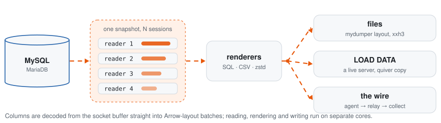
</picture>

- **One snapshot.** `FLUSH TABLES WITH READ LOCK` or MariaDB `BACKUP STAGE`; every session opens
  its transaction in parallel under the lock, so the lock lasts one round trip. The binlog
  position and GTID set are taken before it is released.
<picture>
  <source media="(prefers-color-scheme: dark)" srcset="assets/snapshot-dark.svg">
  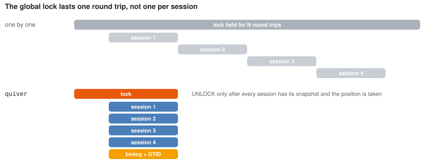
</picture>

- **Even chunks.** Key ranges are bisected by the server's `EXPLAIN` estimates and small
  neighbours are merged, so skewed tables split evenly. Data flows from the first second and the
  DDL of small tables is taken along the way.
- **Separate stages.** Readers, renderers (SQL, CSV, zstd) and writers run on their own cores,
  joined by bounded queues. Doubles are printed by zmij, about 13× faster than Grisu3.

<picture>
  <source media="(prefers-color-scheme: dark)" srcset="assets/tail-dark.svg">
  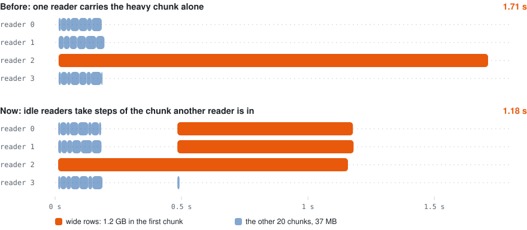
</picture>

*A table whose first 1,200 rows hold 1 MB each: every chunk has the same number of rows, one
of them carries 1.2 GB. Four readers, four renderers, the same flags in both runs. Each bar is a
part of the dump, from the reader's manifest.*

## Numbers

<picture>
  <source media="(prefers-color-scheme: dark)" srcset="assets/bench-dark.svg">
  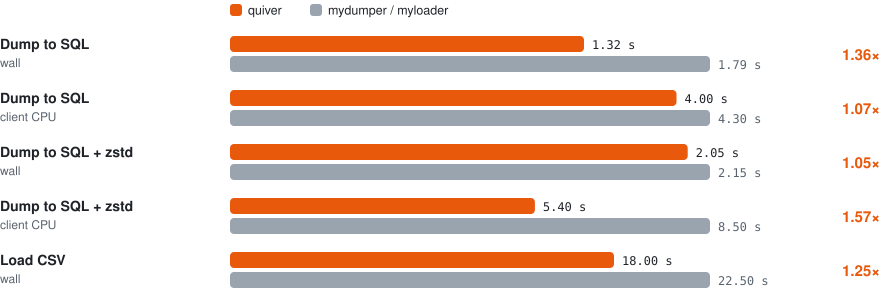
</picture>

*Apple M5 laptop, MySQL 8.4 in Docker, 4 threads, 3 runs, warm buffer pool, 1.3 GB with
narrow and wide rows, integer and string keys and BLOBs. Scripts: `bench/run.sh`,
`bench/load.sh`, `bench/wire.sh`.*

Agent to collector:

| | before | quiver | |
|---|---|---|---|
| 1 MB/s per flow, 50 ms RTT, streams grown online | 35.7 s on 4 streams | **12.6 s** | 2.8× faster |
| 100 ms RTT, mutual TLS, 16 streams opened at once | 2.9 s | **1.25 s** | 2.3× faster |
| Agent CPU, frames written without copies | | | 31 % less |

## Install

Release binaries run on Linux (x86_64 and arm64, glibc 2.34 or later: RHEL, Rocky and Alma 9,
Debian 12, Ubuntu 22.04 and newer) and on macOS 14 or later on Apple silicon. OpenSSL and zstd
are built in.

```sh
brew install jongleb/tap/quiver                                                  # macOS and Linux
curl -fsSL https://raw.githubusercontent.com/jongleb/quiver/main/install.sh | sh  # any of them, into ~/.local/bin
```

<details>
<summary><b>Debian, Ubuntu</b> (apt)</summary>

```sh
curl -fsSL https://jongleb.github.io/quiver/quiver.gpg | sudo tee /usr/share/keyrings/quiver.gpg >/dev/null
echo "deb [signed-by=/usr/share/keyrings/quiver.gpg] https://jongleb.github.io/quiver/deb stable main" \
  | sudo tee /etc/apt/sources.list.d/quiver.list
sudo apt update && sudo apt install quiver
```

</details>

<details>
<summary><b>Fedora, RHEL, Rocky, Alma</b> (dnf)</summary>

```sh
sudo curl -fsSLo /etc/yum.repos.d/quiver.repo https://jongleb.github.io/quiver/quiver.repo
sudo dnf install quiver
```

</details>

<details>
<summary><b>Arch Linux</b> (AUR), <b>Docker</b></summary>

```sh
yay -S quiver-bin
docker run --rm --user "$(id -u):$(id -g)" -v "$PWD:/work" ghcr.io/jongleb/quiver dump -h db.example -u backup -o ./dump
```

</details>

<details>
<summary><b>From source</b></summary>

You need opam, pkg-config and the zstd and OpenSSL libraries. quiver builds with
[OxCaml](https://oxcaml.org), Jane Street's OCaml, on its libraries (Base, Core, ppx_jane):

```sh
git clone https://github.com/jongleb/quiver.git && cd quiver
opam switch create quiver-ox 5.2.0+ox \
  --repos ox=git+https://github.com/oxcaml/opam-repository.git,default
opam install --switch=quiver-ox . --deps-only --with-test
opam exec --switch=quiver-ox -- dune build
```

</details>

`install.sh` reads `QUIVER_INSTALL_DIR` and `QUIVER_VERSION`. Every release also carries the
archives, `.deb` and `.rpm` packages and their `SHA256SUMS` on
[GitHub Releases](https://github.com/jongleb/quiver/releases).

## Quick start

```sh
quiver dump    # MySQL to files: mydumper-compatible SQL or CSV, optional zstd, checksummed manifest
quiver load    # files to MySQL: parallel, streaming, resumes after a crash
quiver copy    # MySQL to MySQL with no files in between
quiver agent   # MySQL to the network, runs next to the source
quiver collect # the network to files or MySQL, runs next to the target, can forward
quiver relay   # a hop that forwards bytes
```

### Dump and load

```sh
quiver dump -h db.example -u backup -p secret -o ./dump           # whole server, threads from the machine
quiver dump -B shop -t 8 --compress zstd -o ./shop                 # one database, 8 readers
quiver dump -T shop.orders --format csv --csv-dialect mysql-load-data -o ./csv
quiver dump -B shop --data-table shop.orders -o ./shop             # every table's schema, rows of orders only
quiver dump -B shop --no-data -o ./schema                          # schema and objects, no rows
quiver dump -T shop.orders --objects none -o ./orders              # without views, triggers, routines, events
quiver dump --snapshot backup-stage -o ./dump                      # MariaDB: block commits only

quiver load -d ./shop -B shop_copy -t 8                            # or: myloader -d ./shop
```

The layout is mydumper's, so `myloader` restores a quiver dump too.

### Copy server to server

```sh
quiver copy -h old.example -B shop --to-host new.example --to-database shop
```

Each chunk streams from its reading session into a loading session of its own through
`LOAD DATA LOCAL INFILE`, in one transaction, while other chunks are still being read. Foreign
keys are added once all data is in.

### Building tablespaces

<picture>
  <source media="(prefers-color-scheme: dark)" srcset="assets/ingest-dark.svg">
  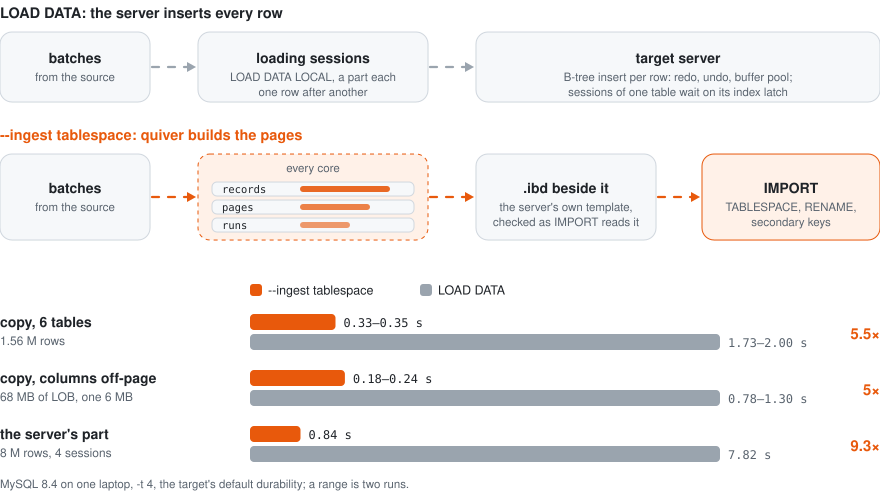
</picture>

```sh
quiver copy -B shop --to-database shop_copy --ingest tablespace --binlog skip
```

`LOAD DATA` makes the target insert every row into its B-tree. Sessions that load the same table
wait on that table's index latch. With `--ingest tablespace`, quiver builds the clustered index
itself.

1. The target creates the table under a name of quiver's, with its primary key and the secondary
   keys quiver can build.
2. `FLUSH TABLES … FOR EXPORT` gives quiver the server's own empty tablespace and `.cfg` file as a
   template.
3. Renderers turn batches into InnoDB records of every index. Runs of each table fill clustered
   pages on threads of their own, and sort their secondary records into a scratch file.
   When the table's last part closes, each secondary index is merged by key ranges on several
   threads.
4. Before the server sees the file, quiver checks it the way `IMPORT` and the server read it.
5. `IMPORT TABLESPACE` takes the file. quiver checks the row count and any warning, renames the
   table and has the server add the secondary keys it did not build.

<picture>
  <source media="(prefers-color-scheme: dark)" srcset="assets/keys-dark.svg">
  
</picture>

- **Types.** Every type a dump reads is stored, including JSON in the server's binary form and
  columns too long for their page (LOB pages). Text in `utf8mb4`, `utf8mb3` and `latin1` is
  stored, and zero dates are kept with `--zero-dates keep`. `STORED` generated columns hold the
  source's own values: quiver reads them for these tables only, and never writes them back
  through `LOAD DATA`.
- **Keys.** Any primary key works, also text in a collation or a float. Rows of such a key are
  stored in the order the source sorted them, and the target checks that order in its own
  collation when it imports the table: a table out of order is refused, not stored. A table without a primary key works too; its
  hidden row ids are numbered by quiver.
- **Secondary keys.** quiver builds keys over integers, dates and times, decimals and binary
  strings (prefixes too) into the file, and checks `UNIQUE` keys itself, since `IMPORT` does
  not. Keys over text in a collation, floats or `DESC` columns, keys of a table without a primary
  key, `SPATIAL` and `FULLTEXT` keys are added by the server after the import, in their places,
  so `SHOW CREATE TABLE` matches the source. This is `--tablespace-keys quiver`; by default
  (`server`) the server adds them all after the import.
- **Checks.** Each stored field and every secondary index record is compared byte for byte with
  records the server wrote itself.
- **Fallback.** A table the writer cannot build goes through `LOAD DATA`, and quiver says why.
  Partitions and other character sets are such cases. At the end, quiver sums up rows and bytes
  by way and by reason, and times each table's import and secondary keys.
- **What it saves.** Writing rows and building byte-ordered keys moves to the client's cores; the
  import then has more pages to take. Tables that fall back load as before.
- **Settings.** `--tablespace-keys server|quiver`, `--sort-dir` (where sorted secondary records
  wait; beside the file by default), `--build-threads` (threads merging a table's indexes).
  `--read-order largest-tables` reads the largest tables first, so their check, import and keys
  run while the rest is read, and `--declare-tables all-at-once` prepares every table before
  the rows; both default to how 1.3.2 worked (`largest-chunks`, `before-rows`).
- **Requirements.** MySQL 8.4 or Percona Server 8.4, and the target's data directory on the same
  machine (`--datadir` if quiver sees it under another path).
- **Binlog.** `--binlog skip` is required: an import writes no rows to the binlog, so replicas
  would silently miss them.

`quiver collect` takes `--ingest tablespace` as well, so an agent can feed a collector next to
the target; the collector tells the agent to read `STORED` generated columns too, and so does a
collector in a chain when a node after it builds tablespaces.

### JSON numbers

<picture>
  <source media="(prefers-color-scheme: dark)" srcset="assets/json-dark.svg">
  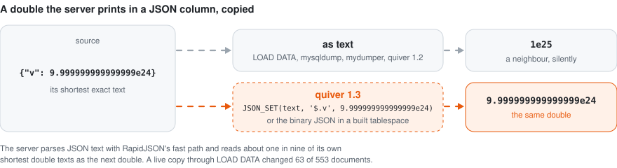
</picture>

MySQL prints a double in JSON as its shortest exact text. When it reads JSON text back, its parser
takes about one in nine of those texts as the neighbouring double, without a warning. Every tool
that moves JSON as text changes such numbers. In a live copy through `LOAD DATA`, 63 of 553
documents came out different.

quiver checks every JSON value with a model of the server's parser and writes values that would
change differently:

- **SQL dumps.** The value becomes `JSON_SET(<text>, <path>, <exact double literal>, …)`. The
  server reads an SQL double literal exactly.
- **`copy` to MySQL.** Such rows bypass `LOAD DATA` and are inserted that way in the same
  transaction.
- **CSV dumps.** Such a value fails with an error; a CSV file has no way to keep it.
- **MariaDB targets.** Their JSON is text, so nothing changes there.

### Connecting

```sh
quiver dump -o ./dump                                              # no -h: the local socket, found as mysql finds it
quiver dump -S /var/run/mysqld/mysqld.sock -o ./dump               # a given socket (skip_networking)
quiver dump -h 127.0.0.1 -o ./dump                                 # local server over TCP
```

- Without `-h` quiver finds the socket as the `mysql` client does: `socket` in the `[client]`
  groups of `my.cnf` with `!include` and `!includedir`, then `MYSQL_UNIX_PORT`, then the
  packaged paths.
- Logins: `caching_sha2_password`, `mysql_native_password`, `sha256_password` with RSA over a
  socket, MariaDB `unix_socket`.
- TLS against system roots by default, your CA with `--tls-ca`, or a pinned certificate with
  `--tls-fingerprint`. `--connect-timeout` bounds connecting, `--net-timeout` bounds silence.

### Settings in a quiverfile

```yaml
# quiverfile.yaml
socket: /var/run/mysqld/mysqld.sock     # every command
to-socket: /var/run/mysqld/mysqld.sock

copy:                                   # quiver copy alone
  database: shop
  to-database: shop_copy
  threads: 8
  ingest: tablespace
  binlog: skip
  data-table: [shop.orders, shop.items]
```

Any option can live in a YAML file, under its long name. Options at the top hold for every
command; those under a command's name hold for it alone, and a list gives the option once per
item. quiver reads `--quiverfile FILE`, else the file in `QUIVERFILE`, else `quiverfile.yaml` in
the current directory, and says which. The command line wins over the environment, and both win
over the file: each option also reads `QUIVER_<NAME>` (`QUIVER_THREADS`, `QUIVER_TO_HOST`, …).
An unknown key is an error, as is a key whose meaning differs between commands (`database`) at
the top. See [quiverfile.example.yaml](quiverfile.example.yaml).

## Across the network

<picture>
  <source media="(prefers-color-scheme: dark)" srcset="assets/wire-dark.svg">
  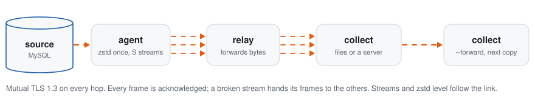
</picture>

```sh
# next to the target
quiver collect --listen 0.0.0.0:7300 --to-host db.local --to-database shop \
  --wire-cert collector.crt --wire-key collector.key --wire-peers nodes-ca.crt

# next to the source
quiver agent -h old.example -B shop --collector collector.example:7300 \
  --wire-cert agent.crt --wire-key agent.key --wire-peers nodes-ca.crt
```

Every connection speaks TLS 1.3 and both ends prove who they are: the agent checks that the
collector's certificate chains to `--wire-peers` and names the host it dialled, and the
collector accepts only agents whose certificates chain there too. Pinning works as well: give
each side the other's self-signed certificate as `--wire-peers`. On a private network,
`--wire-tls disabled` opts out.

Add hops and targets with the same pieces (`$WIRE` stands for the three `--wire-` options):

```sh
quiver relay   --listen 0.0.0.0:7300 --forward far.example:7300 $WIRE                  # a hop
quiver collect --listen 0.0.0.0:7300 -o ./shop --forward replica.example:7300 $WIRE  # keep a copy, pass it on
```

One read of the source reaches a whole chain of targets, each in its own format: files here, a
live server there. A chunk counts once every target has committed it.

### The wire protocol

One control connection carries the session; S data connections carry frames of batches, every
frame with its own two checksums.

<picture>
  <source media="(prefers-color-scheme: dark)" srcset="assets/frame-dark.svg">
  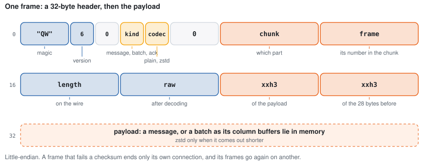
</picture>

<picture>
  <source media="(prefers-color-scheme: dark)" srcset="assets/session-dark.svg">
  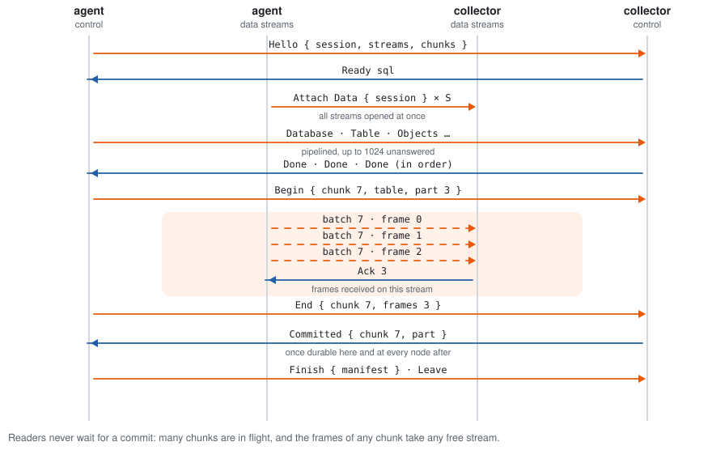
</picture>

<picture>
  <source media="(prefers-color-scheme: dark)" srcset="assets/resilience-dark.svg">
  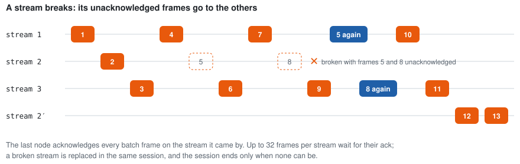
</picture>

<picture>
  <source media="(prefers-color-scheme: dark)" srcset="assets/tuning-dark.svg">
  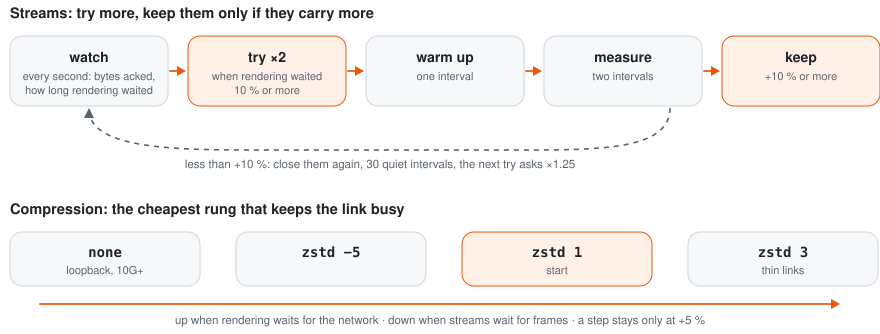
</picture>

<details>
<summary><b>A CA for your nodes in three commands</b></summary>

```sh
openssl req -x509 -newkey ec -pkeyopt ec_paramgen_curve:P-256 -nodes -days 3650 \
  -subj /CN=nodes-ca -keyout nodes-ca.key -out nodes-ca.crt
openssl req -newkey ec -pkeyopt ec_paramgen_curve:P-256 -nodes -subj /CN=collector \
  -keyout collector.key -out collector.csr
openssl x509 -req -in collector.csr -CA nodes-ca.crt -CAkey nodes-ca.key -days 825 \
  -extfile <(echo subjectAltName=DNS:collector.example) -out collector.crt
```

Repeat the last two for the agent and every relay.

</details>

## Correctness

- If the requested consistency cannot be given, quiver refuses to start.
- Floats in their shortest exact form, decimals and fractional seconds as stored. A lossy
  conversion is an error. Zero dates are an error unless kept explicitly.
- JSON doubles the server would read back as their neighbour are written as exact SQL literals.
- `LOAD DATA LOCAL` must store exactly the rows sent and raise no warning. Otherwise the part
  rolls back and the error carries the server's warnings.
- A built tablespace passes quiver's own check of every page, list and LOB before the server
  sees it. After the import, its row count must match the rows sent.
- Chunks cover each key domain exactly, also when a chunk is divided while it is read: the open
  edges are first bounded by `MIN` and `MAX` inside the snapshot.
- xxh3 of every file in the manifest, checked by `quiver load`. On the wire every frame and
  header has its own checksum, inside mutual TLS 1.3 with a key update every 64 GiB.
- Any failure exits non-zero with a typed error and writes no manifest, so an unfinished dump
  never looks finished. `quiver load` records each file in the same transaction as its data and
  resumes after a crash.
- Integration tests on MySQL 8.0 and 8.4 and MariaDB 10.11, 11.4 and 11.8: random tables of every
  type dumped and restored, Sakila with all objects through `myloader` and quiver, bank transfers
  under concurrent writes, resets, silent peers, killed sessions and a full disk.
- Network sessions are property tests: random topologies with relays and chains run while
  connections are cut, corrupted and reset. Either every node commits every part or every node
  fails.

## Status

quiver is young and moving fast.

| Area | |
|---|---|
| Dump, load and copy; separate schema and rows | shipped |
| Tablespaces built on the client (MySQL 8.4, Percona 8.4) | new in 1.3 |
| Unix sockets, `my.cnf`, every common login | shipped |
| Agent, collector, relays and chains, mutual TLS 1.3 | shipped |
| Online tuning of streams, compression, readers; chunks divided while read | shipped |
| Resuming a network transfer from the same snapshot | next |
| Postgres and other providers | after MySQL is done |

Run `quiver <command> --help` for every option.

## License

quiver is free software under the [GNU Affero General Public License v3.0](LICENSE) or any later
version. You may use, change and share it. If you distribute a modified quiver, or run one as a
service that others reach over a network, you must offer them its source under the same licence.
The vendored zmij (`vendor/zmij`, MIT), xxHash (`vendor/xxhash`, BSD-2-Clause) and YAMLx
(`vendor/yamlx`, AGPL-3.0-only) keep their own licences. Release binaries also carry OpenSSL (Apache-2.0) and zstd (BSD-3-Clause), whose
licences ship next to the binary in `licenses/`.
