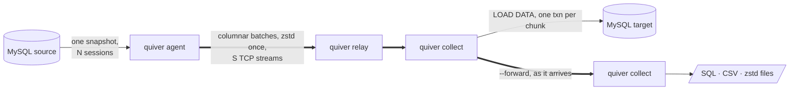

<div align="center">

<picture>
  <source media="(prefers-color-scheme: dark)" srcset="assets/logo-dark.svg">
  
</picture>

# quiver

**Move MySQL and MariaDB data faster than the tools you use today, and keep it consistent.**

Dump · Load · Copy server to server · Stream across networks through relays and chains of targets.
One snapshot, every core, its own wire protocol.

[](https://github.com/jongleb/quiver/actions/workflows/ci.yml)


[](LICENSE)

</div>

---

```console
$ quiver dump -h db.example -u backup -B shop -t 8 --compress zstd -o ./shop
dumped 48211907 rows in 312 chunks into ./shop
Global_read_lock held for 41ms
```

## What quiver is

quiver is a logical dumper and data mover for MySQL and MariaDB, written from scratch in OCaml 5:
an embeddable library with a thin command-line tool.

It doesn't wrap `mysqldump` or link `libmysqlclient`. quiver speaks the MySQL client/server
protocol itself. It decodes binary rows straight from the socket buffer into columnar batches,
with no allocation per cell. Every core works in parallel, and every session reads one
consistent snapshot.

The goal is plain: be the fastest and most trustworthy way to get data out of one MySQL and into
another, whether the other one is a directory, a server next door or a server on another continent.

## Numbers

Measured on a laptop: Apple M5, MySQL 8.4 in Docker, 4 threads, median of 3 runs. These are our
own numbers on our own data; reproduce them with `bench/run.sh`, `bench/load.sh` and
`bench/wire.sh`.

| | quiver | the usual tool | |
|---|---|---|---|
| Dump to SQL, wall time | **1.76 s** | mydumper 2.24 s | **1.27× faster** |
| Dump to SQL + zstd, wall time | **2.23 s** | mydumper 2.67 s | **1.20× faster** |
| Dump to SQL + zstd, client CPU | **5.2 s** | mydumper 7.6 s | **1.45× less CPU** |
| Load 1.3 GB (no secondary indexes), CSV | **18.0 s** | myloader 22.5 s | **1.25× faster** |
| Agent → collector over 100 ms RTT, 1 MB/s per flow, mutual TLS | **1.25 s** (16 streams) | 1.6 s (one stream per reader) | **1.3× faster** |

## One tool, five verbs

```sh
quiver dump    # MySQL → files: mydumper-compatible SQL or CSV, optional zstd, a checksummed manifest
quiver load    # files → MySQL: parallel and streaming, resumes after a crash
quiver copy    # MySQL → MySQL with no files in between
quiver agent   # MySQL → the network: next to the source
quiver collect # the network → files or MySQL: next to the target, can pass everything on
quiver relay   # a hop in between that passes bytes along
```



## Why it's fast

- **Its own protocol client.** Handshake, `caching_sha2_password`, TLS, prepared statements and
  the binary row format are implemented in OCaml on Eio. Between the socket and your data there
  is nothing in C except OpenSSL.
- **No allocation per cell.** Rows land in Arrow-style column buffers straight from the network
  buffer. Integers and doubles are copied, text is copied once, and dates are decoded without
  intermediate structs. Doubles are printed with zmij, which is about 13× faster than Grisu3.
- **Every core.** Reader domains, render domains (SQL, CSV, zstd) and writers run
  in parallel, joined by bounded queues, so backpressure never needs a buffer that grows.
- **Chunks cut by the server's estimates.** quiver bisects key ranges by `EXPLAIN` row estimates
  and then merges small neighbours. Skewed tables split evenly, and every reader gets several
  chunks, so the slowest one doesn't hold the dump back.
- **Readers, streams and commits are tuned apart.** Readers never wait for a commit. On a long
  path, more TCP streams than readers fill the pipe. Control requests are pipelined, so a
  thousand tables don't cost a thousand round trips.
- **The wire tunes itself.** While the network holds the dump back, the agent opens more
  streams and keeps them only when they carry more; it compresses harder when bytes are scarce
  and lighter when the CPU is. On a path of 1 MB/s per flow, a table went from 35.7 s on four
  streams to 12.6 s. `--max-rate` and `--dscp` keep it polite on a shared link.
- **A broken connection is not a failed dump.** Every frame is acknowledged; when a data
  connection breaks, its unacknowledged frames move to the others, duplicates are dropped and
  the connection is replaced. When the control connection breaks, or goes silent for 15 s,
  the agent keeps its snapshot and reconnects within `--reconnect` (60 s): both sides send
  again only what the other did not get, through relays too.

## Why you can trust it

- **One consistent snapshot.** `FLUSH TABLES WITH READ LOCK` or MariaDB's `BACKUP STAGE` is held
  only while N sessions open their transactions. The binlog position and GTID set are recorded
  before the lock is released, and the lock time is printed and stored. The consistency level
  never drops silently: if a mode can't guarantee it, quiver refuses to start.
- **Exact values.** Floats are written in their shortest exact form, and decimals and fractional
  seconds as they are stored. A conversion that would lose precision is an error, not a
  truncation. Zero dates are an error unless you ask to keep them.
- **Checksums end to end.** Every file is hashed with xxh3 into the manifest, and `quiver load`
  rolls back a file that doesn't match. Over the network, every frame and every header carries
  its own checksum, inside mutual TLS 1.3.
- **A chunk counts only once it's durable.** A chunk counts once it has committed on the target,
  on every target in a chain. If anything fails, the run exits non-zero with a typed error and
  leaves no manifest, so a half-done dump never looks finished.
- **Resumable loads.** `quiver load` records each file in the same transaction as its data, so
  after a crash it skips what was committed and loads the rest.
- **Tested against real servers.** quiver runs against MySQL 8.0 and 8.4 and MariaDB 10.11,
  11.4 and 11.8 in Docker: Sakila with views, triggers, routines and events restored by
  `myloader` and by quiver, a bank-transfer workload under concurrent writes, and chaos tests
  for reset connections, silent peers, killed sessions and a full disk.

## Install

Release binaries run on Linux (x86_64 and arm64, glibc 2.34 or later: RHEL, Rocky and Alma 9,
Debian 12, Ubuntu 22.04 and newer) and on macOS 14 or later on Apple silicon. OpenSSL and zstd are built in.

**Homebrew** (macOS and Linux):

```sh
brew install jongleb/tap/quiver
```

**Debian, Ubuntu** (apt):

```sh
curl -fsSL https://jongleb.github.io/quiver/quiver.gpg | sudo tee /usr/share/keyrings/quiver.gpg >/dev/null
echo "deb [signed-by=/usr/share/keyrings/quiver.gpg] https://jongleb.github.io/quiver/deb stable main" \
  | sudo tee /etc/apt/sources.list.d/quiver.list
sudo apt update && sudo apt install quiver
```

**Fedora, RHEL, Rocky, Alma** (dnf):

```sh
sudo curl -fsSLo /etc/yum.repos.d/quiver.repo https://jongleb.github.io/quiver/quiver.repo
sudo dnf install quiver
```

**Arch Linux** (AUR): `yay -S quiver-bin`

**Docker**:

```sh
docker run --rm --user "$(id -u):$(id -g)" -v "$PWD:/work" ghcr.io/jongleb/quiver dump -h db.example -u backup -o ./dump
```

**Any Linux or macOS**, into `~/.local/bin` (`QUIVER_INSTALL_DIR` and `QUIVER_VERSION` change
that):

```sh
curl -fsSL https://raw.githubusercontent.com/jongleb/quiver/main/install.sh | sh
```

Every release also carries the archives, `.deb` and `.rpm` packages and their `SHA256SUMS` on
[GitHub Releases](https://github.com/jongleb/quiver/releases).

### From source

You need opam, pkg-config and the zstd and OpenSSL libraries. quiver builds with
[OxCaml](https://oxcaml.org), Jane Street's OCaml, on its libraries (Base, Core, ppx_jane):

```sh
git clone https://github.com/jongleb/quiver.git && cd quiver
opam switch create quiver-ox 5.2.0+ox \
  --repos ox=git+https://github.com/oxcaml/opam-repository.git,default
opam install --switch=quiver-ox . --deps-only --with-test
opam exec --switch=quiver-ox -- dune build
```

## Quick start

### Dump and load

```sh
quiver dump -h db.example -u backup -p secret -t 8 -o ./dump      # whole server
quiver dump -B shop --compress zstd -o ./shop                      # one database
quiver dump -T shop.orders --format csv --csv-dialect mysql-load-data -o ./csv
quiver dump --snapshot backup-stage -o ./dump                      # MariaDB: block commits only
quiver dump -S /var/run/mysqld/mysqld.sock -o ./dump              # over a Unix socket (skip_networking)
quiver dump -o ./dump                                              # no -h: the local socket, as mysql (my.cnf [client], MYSQL_UNIX_PORT)
quiver dump -h 127.0.0.1 -o ./dump                                 # local server over TCP

quiver load -d ./shop -B shop_copy -t 8                            # or: myloader -d ./shop
```

The layout is mydumper's, so `myloader` restores a quiver dump too.

### Copy server to server

```sh
quiver copy -h old.example -B shop -t 8 --to-host new.example --to-database shop
```

Each chunk streams from its reading session into a loading session of its own through
`LOAD DATA LOCAL INFILE`, in one transaction, while other chunks are still being read.

### Across the network

```sh
# next to the target
quiver collect --listen 0.0.0.0:7300 --to-host db.local --to-database shop \
  --wire-cert collector.crt --wire-key collector.key --wire-peers nodes-ca.crt

# next to the source
quiver agent -h old.example -B shop -t 8 --streams 16 --collector collector.example:7300 \
  --wire-cert agent.crt --wire-key agent.key --wire-peers nodes-ca.crt
```

Every connection speaks TLS 1.3, and both ends must prove who they are: the agent checks that
the collector's certificate chains to `--wire-peers` and names the host it dialled, and the
collector accepts only agents whose certificates chain there too. Nobody else can feed your
target or read your data. Pinning works as well: give each side the other's self-signed
certificate as `--wire-peers`. On a private network you can opt out with `--wire-tls disabled`.

A CA for your nodes takes three commands:

```sh
openssl req -x509 -newkey ec -pkeyopt ec_paramgen_curve:P-256 -nodes -days 3650 \
  -subj /CN=nodes-ca -keyout nodes-ca.key -out nodes-ca.crt
openssl req -newkey ec -pkeyopt ec_paramgen_curve:P-256 -nodes -subj /CN=collector \
  -keyout collector.key -out collector.csr
openssl x509 -req -in collector.csr -CA nodes-ca.crt -CAkey nodes-ca.key -days 825 \
  -extfile <(echo subjectAltName=DNS:collector.example) -out collector.crt
```

(repeat the last two for the agent and every relay).

Add hops and targets with the same pieces (`$WIRE` stands for the three `--wire-` options):

```sh
quiver relay   --listen 0.0.0.0:7300 --forward far.example:7300 $WIRE                  # a hop
quiver collect --listen 0.0.0.0:7300 -o ./shop --forward replica.example:7300 $WIRE  # keep a copy, pass it on
```

One read of the source reaches a whole chain of targets, each in its own format: files here, a
live server there. Each hop terminates TLS and opens its own to the next, with one certificate
for both sides.

## Status

quiver is young and moving fast.

| Area | State |
|---|---|
| Dump, load and copy | ✅ |
| Agent, collector, relays and chains | ✅ (wire protocol v5) |
| Mutual TLS 1.3 on the wire protocol, with key updates | ✅ |
| Broken data connections resent and replaced | ✅ |
| Online tuning of streams and compression, rate cap, DSCP | ✅ |
| Resuming a network transfer from the same snapshot | 🚧 next |
| Postgres and other providers | 🗺️ after MySQL is done |

Run `quiver <command> --help` for every option.

## License

quiver is free software under the [GNU Affero General Public License v3.0](LICENSE) or any later
version. You may use, change and share it. If you distribute a modified quiver, or run one as a
service that others reach over a network, you must offer them its source under the same licence.
The vendored zmij (`vendor/zmij`, MIT) and xxHash (`vendor/xxhash`, BSD-2-Clause) keep their own
licences; release binaries also carry OpenSSL (Apache-2.0) and zstd (BSD-3-Clause), whose
licences ship next to the binary in `licenses/`.
