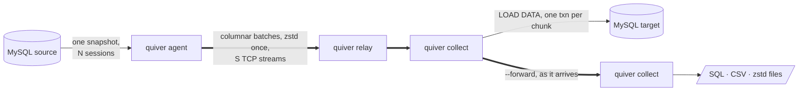

<div align="center">

<picture>
  <source media="(prefers-color-scheme: dark)" srcset="assets/logo-dark.svg">
  
</picture>

# quiver

A MySQL and MariaDB dumper and data mover with its own protocol client and its own network
transport. Dump, load, copy between servers and stream across networks from one consistent
snapshot.

[](https://github.com/jongleb/quiver/actions/workflows/ci.yml)


[](LICENSE)

<table>
<tr>
<td align="center" width="25%"><h2>1.36×</h2>faster than mydumper<br><sub>SQL dump, wall time</sub></td>
<td align="center" width="25%"><h2>1.57×</h2>less client CPU<br><sub>SQL + zstd dump</sub></td>
<td align="center" width="25%"><h2>2.8×</h2>faster on a thin link<br><sub>streams and compression tuned online</sub></td>
<td align="center" width="25%"><h2>0</h2>allocations per cell<br><sub>socket to columns to file</sub></td>
</tr>
</table>

</div>

---

```console
$ quiver dump -h db.example -u backup -B shop -t 8 --compress zstd -o ./shop
dumped 48211907 rows in 312 chunks into ./shop
Global_read_lock held for 41ms
```

## What is new

1. No client library. quiver implements the MySQL protocol itself and decodes binary rows from
   the network buffer straight into Arrow-layout column buffers. A whole dump allocates 0.05
   words per row.
2. A transport for database data. The agent next to the source sends columnar batches over many
   TCP streams, compressed once. Relays forward bytes. Collectors write files or load a server
   and can forward everything to the next collector, so one read of the source reaches a chain
   of targets. A chunk counts once every target has committed it.
3. The transport tunes itself. Each second the agent measures delivered bytes. It adds streams
   while the network is the bottleneck and keeps them only if throughput grows, and it moves
   zstd between none, fast, 1 and 3. On a 1 MB/s per flow link this took a table from 35.7 s to
   12.6 s.
4. Broken connections do not end the dump. Every frame is acknowledged. A broken data connection
   hands its unacknowledged frames to the other streams and is replaced. A broken control
   connection is replaced while the agent holds its snapshot, and each side resends only what
   the other has not received.
5. The global lock lasts one round trip. All N sessions open their snapshots in parallel under
   the lock.
6. The compiler checks the parallelism. Thread bodies are checked by OxCaml modes. Shared state
   lives only in capsules, atomics and queues, with no unsafe casts.
7. Optimisations are checked by mutation. Fast code is compared with a simple model by property
   tests, and every test is shown to fail on deliberately broken code.

## Numbers

Apple M5 laptop, MySQL 8.4 in Docker, 4 threads, 3 runs, warm buffer pool, 1.3 GB of data with
narrow and wide rows, integer and string keys and BLOBs. Scripts: `bench/run.sh`,
`bench/load.sh`, `bench/wire.sh`.

| | quiver | mydumper / myloader | |
|---|---|---|---|
| Dump to SQL, wall time | **1.32 s** | 1.79 s | 1.36× faster |
| Dump to SQL, client CPU | **4.0 s** | 4.3 s | 0.94× |
| Dump to SQL + zstd, wall time | **2.05 s** | 2.15 s | on par |
| Dump to SQL + zstd, client CPU | **5.4 s** | 8.5 s | 1.57× less |
| Load, CSV | **18.0 s** | 22.5 s | 1.25× faster |

Agent to collector:

| | before | quiver | |
|---|---|---|---|
| 1 MB/s per flow, 50 ms RTT, streams grown online | 35.7 s on 4 streams | **12.6 s** | 2.8× faster |
| 100 ms RTT, mutual TLS, 16 streams opened at once | 2.9 s | **1.25 s** | 2.3× faster |
| Agent CPU, frames written without copies | | | 31 % less |

## Commands

```sh
quiver dump    # MySQL to files: mydumper-compatible SQL or CSV, optional zstd, checksummed manifest
quiver load    # files to MySQL: parallel, streaming, resumes after a crash
quiver copy    # MySQL to MySQL with no files in between
quiver agent   # MySQL to the network, runs next to the source
quiver collect # the network to files or MySQL, runs next to the target, can forward
quiver relay   # a hop that forwards bytes
```



## Speed

- Readers, renderers (SQL, CSV, zstd) and writers run on separate cores, joined by bounded
  queues.
- Key ranges are bisected by `EXPLAIN` estimates and small neighbours are merged, so skewed
  tables split evenly and each reader gets several chunks. Data flows from the first second and
  DDL is taken along the way.
- Readers do not wait for commits. Network streams are sized apart from readers. Control
  requests are pipelined.
- Doubles are printed by zmij, about 13× faster than Grisu3, straight into the output buffer.

## Correctness

- One snapshot for all sessions under `FLUSH TABLES WITH READ LOCK` or MariaDB `BACKUP STAGE`.
  The binlog position and GTID set are taken before the lock is released. If the requested
  consistency cannot be given, quiver refuses to start.
- Floats in their shortest exact form, decimals and fractional seconds as stored. A lossy
  conversion is an error. Zero dates are an error unless kept explicitly.
- xxh3 of every file in the manifest, checked by `quiver load`. On the wire every frame and
  header has its own checksum, inside mutual TLS 1.3 with a key update every 64 GiB.
- Any failure exits non-zero with a typed error and writes no manifest, so an unfinished dump
  never looks finished.
- `quiver load` records each file in the same transaction as its data and resumes after a crash.
- Integration tests on MySQL 8.0 and 8.4 and MariaDB 10.11, 11.4 and 11.8: random tables of every
  type dumped and restored, Sakila with all objects through `myloader` and quiver, bank transfers
  under concurrent writes, resets, silent peers, killed sessions and a full disk.
- Network sessions are property tests. Random topologies with relays and chains run while
  connections are cut, corrupted and reset. Either every node commits every part or every node
  fails.

## Connecting

- Without `-h` quiver uses the local socket and finds it as the `mysql` client does: `socket` in
  the `[client]` groups of `my.cnf` with `!include` and `!includedir`, then `MYSQL_UNIX_PORT`,
  then the packaged paths. Servers with `skip_networking` work as they are.
- Logins: `caching_sha2_password`, `mysql_native_password`, `sha256_password` with RSA over a
  socket, MariaDB `unix_socket`.
- TLS against system roots by default, your CA with `--tls-ca`, or a pinned certificate with
  `--tls-fingerprint`.
- `--connect-timeout` (10 s) bounds connecting, `--net-timeout` bounds silence afterwards.

## Install

Release binaries run on Linux (x86_64 and arm64, glibc 2.34 or later: RHEL, Rocky and Alma 9,
Debian 12, Ubuntu 22.04 and newer) and on macOS 14 or later on Apple silicon. OpenSSL and zstd are built in.

**Homebrew** (macOS and Linux):

```sh
brew install jongleb/tap/quiver
```

**Debian, Ubuntu** (apt):

```sh
curl -fsSL https://jongleb.github.io/quiver/quiver.gpg | sudo tee /usr/share/keyrings/quiver.gpg >/dev/null
echo "deb [signed-by=/usr/share/keyrings/quiver.gpg] https://jongleb.github.io/quiver/deb stable main" \
  | sudo tee /etc/apt/sources.list.d/quiver.list
sudo apt update && sudo apt install quiver
```

**Fedora, RHEL, Rocky, Alma** (dnf):

```sh
sudo curl -fsSLo /etc/yum.repos.d/quiver.repo https://jongleb.github.io/quiver/quiver.repo
sudo dnf install quiver
```

**Arch Linux** (AUR): `yay -S quiver-bin`

**Docker**:

```sh
docker run --rm --user "$(id -u):$(id -g)" -v "$PWD:/work" ghcr.io/jongleb/quiver dump -h db.example -u backup -o ./dump
```

**Any Linux or macOS**, into `~/.local/bin` (`QUIVER_INSTALL_DIR` and `QUIVER_VERSION` change
that):

```sh
curl -fsSL https://raw.githubusercontent.com/jongleb/quiver/main/install.sh | sh
```

Every release also carries the archives, `.deb` and `.rpm` packages and their `SHA256SUMS` on
[GitHub Releases](https://github.com/jongleb/quiver/releases).

### From source

You need opam, pkg-config and the zstd and OpenSSL libraries. quiver builds with
[OxCaml](https://oxcaml.org), Jane Street's OCaml, on its libraries (Base, Core, ppx_jane):

```sh
git clone https://github.com/jongleb/quiver.git && cd quiver
opam switch create quiver-ox 5.2.0+ox \
  --repos ox=git+https://github.com/oxcaml/opam-repository.git,default
opam install --switch=quiver-ox . --deps-only --with-test
opam exec --switch=quiver-ox -- dune build
```

## Quick start

### Dump and load

```sh
quiver dump -h db.example -u backup -p secret -t 8 -o ./dump      # whole server
quiver dump -B shop --compress zstd -o ./shop                      # one database
quiver dump -T shop.orders --format csv --csv-dialect mysql-load-data -o ./csv
quiver dump --snapshot backup-stage -o ./dump                      # MariaDB: block commits only
quiver dump -S /var/run/mysqld/mysqld.sock -o ./dump              # over a Unix socket (skip_networking)
quiver dump -o ./dump                                              # no -h: the local socket, as mysql (my.cnf [client], MYSQL_UNIX_PORT)
quiver dump -h 127.0.0.1 -o ./dump                                 # local server over TCP

quiver load -d ./shop -B shop_copy -t 8                            # or: myloader -d ./shop
```

The layout is mydumper's, so `myloader` restores a quiver dump too.

### Copy server to server

```sh
quiver copy -h old.example -B shop -t 8 --to-host new.example --to-database shop
```

Each chunk streams from its reading session into a loading session of its own through
`LOAD DATA LOCAL INFILE`, in one transaction, while other chunks are still being read.

### Across the network

```sh
# next to the target
quiver collect --listen 0.0.0.0:7300 --to-host db.local --to-database shop \
  --wire-cert collector.crt --wire-key collector.key --wire-peers nodes-ca.crt

# next to the source
quiver agent -h old.example -B shop -t 8 --streams 16 --collector collector.example:7300 \
  --wire-cert agent.crt --wire-key agent.key --wire-peers nodes-ca.crt
```

Every connection speaks TLS 1.3, and both ends must prove who they are: the agent checks that
the collector's certificate chains to `--wire-peers` and names the host it dialled, and the
collector accepts only agents whose certificates chain there too. Nobody else can feed your
target or read your data. Pinning works as well: give each side the other's self-signed
certificate as `--wire-peers`. On a private network you can opt out with `--wire-tls disabled`.

A CA for your nodes takes three commands:

```sh
openssl req -x509 -newkey ec -pkeyopt ec_paramgen_curve:P-256 -nodes -days 3650 \
  -subj /CN=nodes-ca -keyout nodes-ca.key -out nodes-ca.crt
openssl req -newkey ec -pkeyopt ec_paramgen_curve:P-256 -nodes -subj /CN=collector \
  -keyout collector.key -out collector.csr
openssl x509 -req -in collector.csr -CA nodes-ca.crt -CAkey nodes-ca.key -days 825 \
  -extfile <(echo subjectAltName=DNS:collector.example) -out collector.crt
```

(repeat the last two for the agent and every relay).

Add hops and targets with the same pieces (`$WIRE` stands for the three `--wire-` options):

```sh
quiver relay   --listen 0.0.0.0:7300 --forward far.example:7300 $WIRE                  # a hop
quiver collect --listen 0.0.0.0:7300 -o ./shop --forward replica.example:7300 $WIRE  # keep a copy, pass it on
```

One read of the source reaches a whole chain of targets, each in its own format: files here, a
live server there. Each hop terminates TLS and opens its own to the next, with one certificate
for both sides.

## Status

quiver is young and moving fast.

| Area | State |
|---|---|
| Dump, load and copy | ✅ |
| Unix sockets, `my.cnf`, every common login | ✅ |
| Agent, collector, relays and chains | ✅ |
| Mutual TLS 1.3 on the wire protocol, with key updates | ✅ |
| Broken data connections resent and replaced | ✅ |
| Online tuning of streams and compression, rate cap, DSCP | ✅ |
| Resuming a network transfer from the same snapshot | 🚧 next |
| Postgres and other providers | 🗺️ after MySQL is done |

Run `quiver <command> --help` for every option.

## License

quiver is free software under the [GNU Affero General Public License v3.0](LICENSE) or any later
version. You may use, change and share it. If you distribute a modified quiver, or run one as a
service that others reach over a network, you must offer them its source under the same licence.
The vendored zmij (`vendor/zmij`, MIT) and xxHash (`vendor/xxhash`, BSD-2-Clause) keep their own
licences. Release binaries also carry OpenSSL (Apache-2.0) and zstd (BSD-3-Clause), whose
licences ship next to the binary in `licenses/`.
